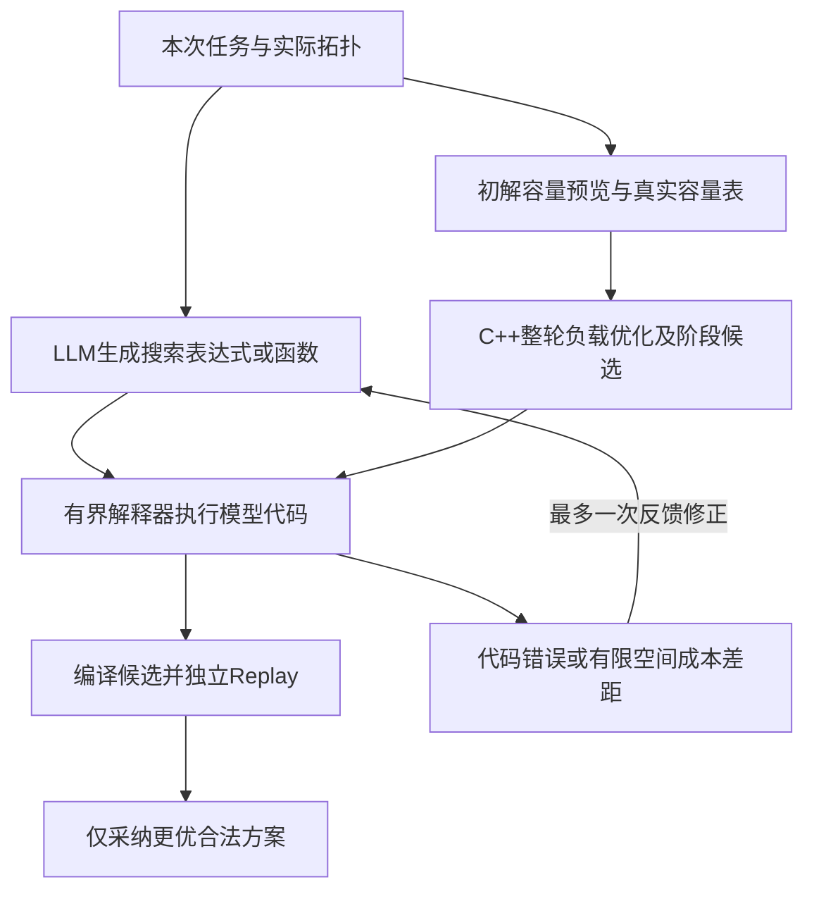

# AgentCC · 1.12

为本次实际网络上的 AllGather / AllReduce 搜索可回放通信调度。**C++ 负责容量和路径数值计算，LLM 生成阶段组合搜索代码，Python 负责官方运行时、编排和独立验证。** 无需 GPU，不训练神经网络。

## 从这里开始

| 内容 | 入口 |
|---|---|
| 完整请求、通信、CPU、Token 与退化项 | [验证报告](VALIDATION.md) |
| 容量模型、算法边界、模型实际作用 | [设计原理](THEORY.md) |
| 当前源码 | [src/](src/) · [native/](native/) |
| 1.12 源码与实验索引 | [artifacts/v1.12](artifacts/v1.12/README.md) |
| 保持 1.6 流程的快速对照 | [1.11 发布包](artifacts/v1.11/README.md) |
| 1.9 / 1.10 退步排查 | [镜像、后端及完整响应审计](artifacts/v1.11/analysis/diagnosis.md) |
| 所有历史版本 | [版本看板](artifacts/index.html) · [目录规范](artifacts/README.md) |

生产开发在根目录进行，发布时复制为 `artifacts/v1.x/source/`。历史快照不随当前开发改动。Git 收录代码、测试、文档和发布快照；原始实验、压缩包、官方材料和本地 SDK 保留在服务器。真实 Key 只放本地 `.env` 或平台环境变量，不进入源码或镜像。

## 题目要求

输入包括本次任务、rank、实际有向边、带宽、共享资源及成员边、数据大小、切分和轮数约束。不能根据拓扑名补出不存在的连接。

- **AllGather：** 每个 rank 最终得到所有源的原始分片。
- **AllReduce：** 合并互不重叠的原始贡献，再分发完整归约结果。
- **轮初语义：** 同轮收到的分片只能从下一轮开始转发；单条路径的内部节点不能是 rank。
- **输出：** `solution` 包含初始/最终分片、逐轮 `transfer`、合法 `route_id` 和 `metrics`。共享资源按全部成员边累计占用，最终由官方 Replay 判断。

已收到的正式公告是 **正确性25 + 通信50 + 求解时间25，单例时限360秒**。专家与 Token 复核另占综合成绩30%。另收到的过程导向鼓励 LLM 生成/修改求解器并根据执行反馈迭代；详细过程评分仍待正式公布。本项目保存过程证据，但不能预先保证专家评分。

## 求解流程



1. 模型请求与本地准备重叠。输入摘要包含当前任务及代表性有向边、共享资源；执行模型代码时使用依据完整实际图计算的成本表。
2. 搜索跨固定区段的通信阶段组合；AllReduce 分别选择归约、广播边界。C++ 对完整原子分流后的整轮负载做有界重选。AllGather 在满足持有不变量时允许更换实际发送者。
3. 通常由模型生成“合并前驱状态并选择最优者”的表达式；框架提供初始化、前驱枚举和外层循环。轮数约束有效时，模型生成完整 `solve(c,limit)` 函数。代码使用受限解释器执行，不使用任意 Python `exec`。
4. 检查阶段、轮数和成本后，只有有希望的候选才编译并完整 Replay。错误或明显次优最多反馈一次。失败或无收益时使用已验证方案，不强制采用模型动作。
5. 初始备用解先做与原构造器一致的容量预览，需要时才生成分片与 transfers。若已有固定区段候选达到有限空间成本界，在模型等待期间完成它的验证；仍执行并记录模型程序。路径计算使用保持 Python 平局规则的 C++ 实现。

模型生成的是受约束的搜索片段。容量建模、路由优化、解释器、编译器和 Replay 是工程代码；不能把全部通信收益归因于模型。有限搜索空间与预算筛选也不保证网络全局最优。具体保证及启发式边界见设计原理。

## 代码结构

```text
src/
  server.py / my_agent.py       官方 AgentRuntime 入口
  generated_service.py         并行准备、模型执行、反馈与验收
  seed_preview.py              备用解的精确容量预览
  code_policy.py / program_vm.py 生成协议、计量、有界解释器
  refined_search.py            阶段成本表及各内核的选择
  stage_search.py / stage_program.py 结构表达、成本审计、编译
  balanced_stages.py           完整原子分流、整轮路由重选
  holder_stages.py             AG 合法持有者重选
  fabric_routes.py             有向路径和共享资源系数
  capacity_backend.py         C++ 后端加载与开发用参考后端
  topology.py / replay.py      输入解析、独立语义及成本检查
  synthesis_service.py        旧流程与非适用规模的明确回退
native/
  capacity.cpp                容量编译及数值循环
  round_optimizer.h           有界整轮负载优化
  shortest_paths.h             保持原选择规则的最短路径内核
  path_compiler.h              请求内容量图及路径系数复用
  build.py                    使用目标 Python 编译
tests/                       回归、真实 SDK 对照、消融与扰动
artifacts/v1.x/              发布快照、实验记录与可视化报告
materials/ / vendor/         本地官方材料及 SDK，不进入镜像
```

历史研究原型放 `artifacts/v1.10/analysis/prototypes/`；本轮实验记录在 `artifacts/v1.12/analysis/`，不从生产模块导入。阶段代码生成适用于2～512个、数量为2的幂的 rank；其他规模沿用旧模型编辑流程并明确记录回退。路径与候选数量有工作量上限。

## 配置与使用

沿用 `.env`：`PLATFORM_LLM_URL`、`PLATFORM_API_KEY`、`PLATFORM_LLM_MODEL`，可选 `AGENTCC_LLM_TIMEOUT_S`。环境变量优先。在官方基础环境中运行：

```bash
python -m src.server
```

最终调用 `AgentRuntime(MyAgent()).run()`，由 SDK 提供 `0.0.0.0:8080` 上的 `/health` 与 `/solve`。请求外层：

```json
{
  "task_id": "实际task_id",
  "task_type": "agentcc",
  "input": {"instance_id": "实际instance_id", "task": {}, "topology": {}},
  "constraints": {"timeout_ms": 360000}
}
```

其中 `task`、`topology` 要填写完整输入。响应 `output.answer` 是 solution；`output.diagnostics` 保存模型原始交互、源码/输入哈希、成本表、执行输出、反馈、采用或拒绝理由、计量和阶段耗时。通常一次模型请求，最多一次修正。

## 验证

已有编译器和 Python 开发头文件时，用服务的同一解释器编译：

```bash
python3 native/build.py
AGENTCC_CAPACITY_BACKEND=cpp PYTHONPATH=vendor:. python3 -m unittest discover -s tests -v
```

项目内已有官方运行时归档时，可使用官方 Python/SDK 做真实交错对照。此工具只读取项目内归档，不运行 Docker：

```bash
python3 -m tests.image_runtime -- native/build.py --output-dir src
AGENTCC_CAPACITY_BACKEND=cpp python3 -m tests.image_runtime -- -m tests.compare_versions --versions 1.11 current --all-public --repeat 3 --output-dir artifacts/v1.12/runs/my-comparison
```

必须使用新实验目录，不覆盖已有记录。计时包含模型等待、搜索、编译、服务内校验、完整响应序列化和解析，单独报告通信回放及 CPU。公开样例与平台冻结输入不同，不据此承诺官方分数；计时期间不要并行运行其他 CPU 实验。

## 构建与导出

```bash
docker build --platform linux/amd64 -t agentcc-team:1.12 /home/czy/agentcc/artifacts/v1.12/source
docker save -o /home/czy/agentcc-images/agentcc-team-1.12.tar agentcc-team:1.12
```

1.11 使用相同命令，将版本改为 `1.11`。本次仅使用用户授权的 `docker build`、`docker save`，未操作服务器其他容器。实际导出结果及校验值记录在各版本 `reports/image.json`。

构建阶段在官方 `agenthack/base:1.1.1` 中编译扩展，最终镜像以非 root 用户 `agent` 运行，只含基础环境、生产代码及编译扩展。运行时不编译；强制 `AGENTCC_CAPACITY_BACKEND=cpp`，缺失扩展会报错。开发时 `auto` 可回退 Python，但这不是发布镜像配置。`.env`、材料、历史快照、实验和本机二进制不进入构建内容，平台仍需提供模型配置。
