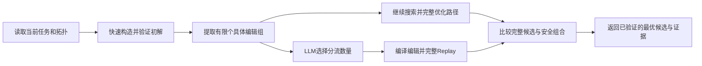

# AgentCC · 1.4

针对当前任务与实际有向拓扑搜索 AllGather / AllReduce 调度。先生成有效方案，让 LLM 提出具体分流数量，同时继续程序搜索；最后验证并选择更快的完整方案。模型动作可以被更好的方案替换。

`1.4` 是项目版本；`V22` 是比赛规则版本。生产入口始终为官方 `AgentRuntime(MyAgent()).run()`，不训练模型，不需要 GPU，不按实例名称套用预存答案。

## 从这里开始

| 内容 | 入口 |
| --- | --- |
| 历史成绩、版本与证据导航 | [离线看板](artifacts/index.html) |
| 新旧版本重复对照与逐例变化 | [交互式实测报告](artifacts/v1.4/reports/comparison/report.html) |
| 当前实测结果与限制 | [VALIDATION.md](VALIDATION.md) |
| 容量模型、正确性论证与模型参与 | [THEORY.md](THEORY.md) |
| 实验目录约定 | [artifacts/README.md](artifacts/README.md) |
| 已评测的 1.3 源码 | [v1.3/source](artifacts/v1.3/source/) |
| 当前 1.4 源码快照 | [v1.4/source](artifacts/v1.4/source/) |

## 求解流程



初解使用当前允许的切分与合法路径。AllGather 优先使用最小合法切分，AllReduce 优先使用最大合法切分；后续搜索继续比较其他候选，不把初始参数视为最优答案。

LLM 收到一个可编辑瓶颈轮中最多两组的共享容量、合法备用路径及负载差分，返回与实际目录绑定的整数数量数组。数量决定具体轮次中哪些完整分片改走备用路径；AllReduce 的完整贡献表达式不能拆开。程序不补造、不修剪模型数量。

模型等待期间，程序继续搜索并执行不冻结模型动作的路径优化。模型候选需胜过完整控制方案，或在原子数据动作相同的轮次上提供改善，才进入最终结果。还可将模型改动的完整原子项迁移到兼容控制轮，保留其他项的程序优化。模型数量和目标路径不被改写。不同切分、不同数据动作的候选只能整体比较，不能凭轮号混合。

新增原子组合预计改善不足总通信成本的0.1%时，跳过额外验证，保留已有赢家。该门槛控制边际开销，不是官方评分预测。每个潜在赢家必须通过完整 Replay。模型提案无效、无变化或不如控制方案时，明确记录原因并保留有效答案。网络、认证或模型服务故障明确失败；`--offline` 仅用于显式算法测试，不伪装模型调用成功。

## 代码结构

```text
src/                          # 唯一被复制进镜像的代码
  server.py / my_agent.py     # 官方运行时入口与请求适配
  service.py                 # 阶段编排、模型与CPU工作重叠
  solver.py / collectives.py # 有效初解、候选搜索、集合通信构造
  schedule_edit.py           # 编辑目录、整数数量编译与验收
  selection.py               # 完整候选、兼容轮次与原子路径组合
  route_balance.py           # 已搜索路径的负载优化
  route_broad.py / route_work.py # 更多合法路径与确定性工作量预算
  topology.py / replay.py     # 实际有向图、共享资源与独立回放
  llm.py / config.py          # 模型协议、证据与配置
  planning.py / cli.py        # 输入摘要与命令行工具
tests/                        # 自动测试和可复用对照工具
materials/                    # 原始规则、公开样例、论文和平台截图录入
vendor/                       # 原版官方SDK副本，仅供宿主机测试
artifacts/                    # 按版本整理的源码快照、实验和报告
```

历史归档统一为 `artifacts/v1.x/source/`，运行输出归 `runs/`，专项分析归 `analysis/`，验证清单与测试日志归 `reports/`。历史文件保留原字节；旧路径可通过迁移清单查找。

## 模型证据

`output.answer` 是完整 solution，通信 metrics 的时间单位为秒。`output.diagnostics` 保存本地 Replay（微秒）、阶段计时、真实模型请求与原始回复、Token 和候选选择历史，不记录认证头或 Key。

`model_edit.accepted` 表示提案改善了它看到的初解；`selected` 表示它整体胜出，或其兼容轮次进入了比控制方案更快的组合。原子组合用 `selected_atomic_positions` 记录精确分片位置；`selected_transfers` 所指的包可能包含其他分片，不能整包归因于模型。它们是观察记录，不是冻结约束。候选历史只有一条最终选中记录，并分别保留模型初解与控制候选的来源，避免把程序优化收益全部归给模型。

提示采用可逆表格与节点/资源别名减少 Token，编辑组保留明确的数量字段。具体编辑请求使用温度0、单次调用；这不保证模型服务完全确定。输入绑定排除诊断计时并包含真实编辑目录，完整波动排查见 [VALIDATION.md](VALIDATION.md)。

## 配置与运行

项目 `.env` 中填写 `PLATFORM_LLM_URL`、`PLATFORM_API_KEY`、`PLATFORM_LLM_MODEL`；进程环境变量优先。当前接口使用 OpenAI 兼容的 Chat Completions 请求格式。

在已有官方基础环境的 `/app` 下执行：

```bash
python -m src.server
```

官方 SDK 提供 `0.0.0.0:8080` 的 `/health` 和 `/solve`。开发容器启动 Bash 不代表比赛服务已经启动。

请求示例：

```json
{
  "task_id": "与task.task_id一致",
  "task_type": "agentcc",
  "input": {
    "instance_id": "与task.instance_id一致",
    "task": {},
    "topology": {}
  },
  "constraints": {"timeout_ms": 180000}
}
```

`task` 与 `topology` 应包含完整实际输入。SDK 未收到超时参数时默认30秒。模型超时默认15秒；后续候选搜索默认1秒，编辑目录使用10,000次候选路径检查与65,000次边松弛的工作预算（3秒异常保护），已有路径优化0.25秒，更多路径优化使用20,000次路径评分与65,000次边松弛的工作预算，并设3秒异常保护。首解保护、完整校验及单次路径计算可以跨过软预算，因此这些数字不是请求硬上限。模型网络等待与控制搜索重叠，不应把所有阶段耗时相加当作端到端时间。

## 测试和版本对照

在项目根目录执行。宿主机通过 `vendor/` 使用原版 SDK；官方基础环境中可省略 `PYTHONPATH=vendor:.`。

```bash
PYTHONPATH=vendor:. python3 -m unittest discover -s tests -v
```

算法测试，不调用模型：

```bash
python3 -m src.cli benchmark --offline --budget 1 \
  --output-dir artifacts/v1.4/runs/offline-retest
PYTHONPATH=vendor:. python3 -m tests.mutation_benchmark \
  --output artifacts/v1.4/analysis/mutations-retest.json
```

真实新旧版本对照会消耗模型配额。可以先用 `--dry-run` 检查版本、输入和调用数量，该模式不读取模型配置、不联网：

```bash
PYTHONPATH=vendor:. python3 -m tests.compare_versions \
  --versions 1.3 1.4 --all-public --repeat 3 \
  --output-dir artifacts/v1.4/runs/comparison-retest --dry-run
```

确认计划后去掉 `--dry-run` 执行。工具要求新建或空的输出目录，依次轮换新旧版本顺序，限制测试进程为一个 CPU 与1 GiB地址空间，并保存每次实际 SDK 响应及源码起止哈希。测试使用官方 ASGI 应用的进程内 HTTP 传输，运行原始请求解析、求解、超时和遥测流程，不启动替代 HTTP 服务。

完成后生成可切换指标与版本的离线报告，不会调用模型：

```bash
python3 -m tests.summarize_comparison \
  artifacts/v1.4/runs/comparison-retest/summary.json
```

多个实验可以连续传入多个 `summary.json`。工具核对同版本源码哈希和测量条件，按样例、版本计算重复中位数；失败请求仍计入有效率和成本，不会因提前失败显示为性能改善。

真实小例与输入变化回归：

```bash
PYTHONPATH=vendor:. python3 -m tests.runtime_benchmark \
  --include-mutation --single-cpu --memory-mib 1024 \
  --output-dir artifacts/v1.4/runs/runtime-retest
```

## 用户构建与提交

开发过程中不执行 Docker。以下命令由用户基于已导入的官方基础镜像执行：

```bash
docker build --platform linux/amd64 -t agentcc-team:1.4 /home/czy/agentcc
docker run --rm --name agentcc-check \
  --cpus=1 --memory=1024m --pids-limit=256 \
  --env-file /home/czy/agentcc/.env \
  -p 8080:8080 agentcc-team:1.4
```

若8080已被开发容器占用，测试端口改为 `-p 8081:8080`。验证后导出：

```bash
docker save -o /home/czy/agentcc-images/agentcc-team-1.4.tar agentcc-team:1.4
```

Dockerfile 仍基于 `agenthack/base:1.1.1`，只复制 `src/`，使用非 root 的 `agent` 用户，执行 `python -m src.server`。`.env`、SDK副本、样例、测试及实验产物不进入镜像；模型配置由运行环境提供。

## 验证边界

公开样例与生成变体不是平台冻结题库，材料也未附官方 Judge 可执行程序或冻结 `L/U/t_good`。本地通过与性能改善不等于官方通过或新得分。

宿主机 Python 为3.10，基础镜像为3.11；单 CPU亲和性与地址空间限制不完全等于容器的CPU配额、内存和pids限制。模型回复、网关负载及软预算搜索会变化，版本对照需重复测量，并分别报告通信、求解时间与Token。
