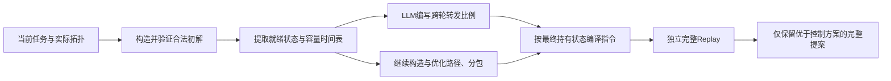

# AgentCC · 1.5

面向实际有向拓扑生成 AllGather / AllReduce 调度。当前交付为 **1.5，revision-05**；V22 是比赛规则版本。官方入口为 `AgentRuntime(MyAgent()).run()`，使用官方 LLM 接口，无需训练网络、安装推理框架或配备 GPU。

本轮让模型编写**跨轮转发指令**：对给出的复制轮，决定保留、提前一半或提前全部已就绪原子。程序依据最终方案的实际持有状态编译这些指令，经完整 Replay 确认更快才采用。模型没有被要求输出庞大的完整调度，也不能直接执行代码。

## 从这里开始

| 内容 | 入口 |
| --- | --- |
| 完整验证结果、退化项与局限 | [VALIDATION.md](VALIDATION.md) |
| 容量模型、程序语义、正确性论证 | [THEORY.md](THEORY.md) |
| 本轮交互式对照报告 | [revision-05/comparison/report.html](artifacts/v1.5/reports/revision-05/comparison/report.html) |
| 历史平台成绩和版本导航 | [artifacts/index.html](artifacts/index.html) |
| 本轮源码快照 | [v1.5/source](artifacts/v1.5/source/) |
| 上一轮1.5原样备份 | [v1.5/iterations/04/source](artifacts/v1.5/iterations/04/source/) |

## 求解流程



模型回复例如 `{"counts":[2,0,1,2,0]}`：对提示中五个轮次，分别提前全部、不改、提前一半、提前全部、不改。0/1/2 的含义固定；程序不填补、不修改或搜索替代数量。比例对每个实际包分别应用，一半向上取整，所有原子保持完整。

模型看到的是当前初解的容量估计。程序搜索期间可以改变 rank 排序、路径和包边界；模型指令事先声明作用于最终同轮结构，不依赖旧包索引。它不能跨实例、跨不同轮数应用。候选与控制方案都使用完整原始拓扑回放；提示的近似数字不参与最终正确性判定。

本次扩大了模型可编辑窗口，并减少路径搜索和提示准备中的重复计算。保留单次模型请求；两/三方案输出试验增加等待且不稳定，未进入生产。

这是一次有限的调度程序合成。程序控制分支不搜索跨轮比例，模型实际增加了这一搜索维度。没有证明全局最优，也没有证据表明模型优于所有同目录贪心或动态规划算法。失败、无收益与退化结果均保留。

## 代码结构

```text
src/                          # 镜像只复制这里
  server.py / my_agent.py     # 官方SDK入口
  forward_service.py         # 生产流程、并行模型调用与验收
  retime_plan.py             # 容量上下文、模型指令的严格编译
  forward_edit.py            # 轮初持有状态、具体转发改写、完整回放验收
  service.py                 # 共享程序控制；保留旧路径编辑流程供对照
  solver.py / collectives.py  # 候选结构与通信构造
  topology.py / replay.py     # 有向图、共享资源、独立语义验证
  route_*.py                 # 有预算的合法路径搜索与负载调整
  packetization.py / postprocess.py # 完整原子分包和容量优化
  schedule_edit.py / selection.py / provenance.py # 旧路径编辑及证据核对
  llm.py / config.py          # 官方模型协议、计量和配置
  planning.py / cli.py        # 输入摘要与命令行工具
tests/                        # 单元、官方SDK对照、消融和扰动测试
materials/                    # 官方材料、公开样例及论文
vendor/                       # 官方SDK原版副本，仅用于本地测试
artifacts/v1.x/               # 按版本组织，历史源码和证据不覆盖
```

本轮实验统一放在 `artifacts/v1.5/{runs,analysis,reports}/revision-05/`。`source/` 是本轮交付快照，旧1.5在 `iterations/04/source/`。本轮对照表的1.4为其原始发布快照，1.5为当前revision-05；项目和镜像版本仍叫1.5。旧研究里的1.5.3/1.5.4是实验标签，不是新的镜像版本。

## 配置与启动

沿用已经填写的 `.env`：`PLATFORM_LLM_URL`、`PLATFORM_API_KEY`、`PLATFORM_LLM_MODEL`，可选 `AGENTCC_LLM_TIMEOUT_S`。环境变量优先。Key 不进入提示、日志或镜像。

在官方基础环境的项目目录运行：

```bash
python -m src.server
```

官方SDK监听 `0.0.0.0:8080`，提供 `/health` 和 `/solve`。启动开发容器的 Bash 不等于启动比赛服务。正式请求格式：

```json
{
  "task_id": "实际task_id",
  "task_type": "agentcc",
  "input": {
    "instance_id": "实际instance_id",
    "task": {},
    "topology": {}
  },
  "constraints": {"timeout_ms": 180000}
}
```

`task` 和 `topology` 必须是完整实际输入。响应的 `output.answer` 是solution；`output.diagnostics` 包含真实模型提示、原始回复、Token、各阶段时间、输入绑定和验收结果。`model_edit.accepted/selected` 在本轮都表示完整模型提案比最终控制方案更快，二者不再指“仅改善初解”。无效回复明确拒绝；模型网络或认证失败不伪装成功。

正常请求一次LLM调用，温度0，输出最多64 Token。温度0不保证完全确定。当前模型目录为最后五个可编辑复制轮，这是有意限制的搜索邻域。构造最多接纳10个候选，路径搜索受确定性工作量限制，另有超时保护；本地验收与输出仍有开销。

## 本地验证

宿主机已具备本项目依赖时，在项目根目录执行；官方基础环境可省略 `PYTHONPATH=vendor:.`：

```bash
PYTHONPATH=vendor:. python3 -m unittest discover -s tests -v
```

以下命令会真实调用官方模型，输出目录必须是新的空目录：

```bash
PYTHONPATH=vendor:. python3 -m tests.compare_versions --versions 1.4 current --all-public \
  --output artifacts/v1.5/runs/revision-05/my-comparison --repeat 3
```

它比较已发布1.4与当前1.5生产入口，14个公开样例、两版、各3次，共84次请求。报告覆盖完整SDK响应；公开样例不等于平台冻结评测输入。

离线扰动无需Key、不会联网，使用合成回复检查语义：

```bash
PYTHONPATH=vendor:. python3 -m tests.retiming_audit mutations \
  --output artifacts/v1.5/analysis/revision-05/my-mutations.json
```

## 由你构建、运行和导出

以下命令由用户执行，本次开发没有执行Docker、导出或上传镜像。Dockerfile继续基于 `agenthack/base:1.1.1`，使用非root用户 `agent`。

```bash
docker build --platform linux/amd64 -t agentcc-team:1.5 /home/czy/agentcc
```

本机检查服务，端口映射到所有网卡：

```bash
docker run --rm --name agentcc-check --cpus=1 --memory=1024m --pids-limit=256 --env-file /home/czy/agentcc/.env -p 8080:8080 agentcc-team:1.5
```

访问 `http://服务器IP:8080/health`，其中“服务器IP”替换为实际地址。确认后导出；文件名加revision以保留之前的1.5：

```bash
docker save -o /home/czy/agentcc-images/agentcc-team-1.5-r05.tar agentcc-team:1.5
```

上传新导出的文件。平台启动时需提供上述模型配置；`.env`、样例、测试、SDK副本和历史结果均不打入镜像。挂载目录不会自动固化到镜像，真正保存源码的是此次构建中的 `COPY src/ /app/src/`。
