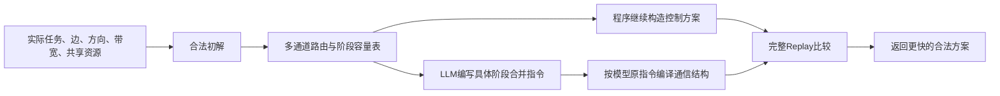

# AgentCC · 1.6

依据本次实际有向拓扑，为 AllGather / AllReduce 生成可回放的通信调度。**1.6 的重点是通信结构：并行通道分配、多路阶段合并、容量约束下的分包。** 官方入口仍是 `AgentRuntime(MyAgent()).run()`；不训练神经网络，不需要 GPU。

## 从这里开始

| 内容 | 入口 |
| --- | --- |
| 完整结果、退化项、测试边界 | [VALIDATION.md](VALIDATION.md) |
| 容量模型、编辑语义与正确性论证 | [THEORY.md](THEORY.md) |
| 1.5 → 1.6 交互式逐例对照 | [对照报告](artifacts/v1.6/reports/comparison/report.html) |
| 结构探索、消融与失败记录 | [1.6 实验目录](artifacts/v1.6/README.md) |
| 历史版本与平台成绩 | [版本看板](artifacts/index.html) |
| 本次交付的独立源码副本 | [v1.6/source](artifacts/v1.6/source/) · [源码压缩包](artifacts/v1.6/agentcc-source-1.6.tar.gz) |

## 求解过程



二叉通信结构在每轮只跨一个 rank 维度。1.6 允许一次跨越最多三个维度，将连续阶段改写为多路通信。模型对相互独立的维度段输出 `keep`、`left`、`right` 或 `all`：保留二叉步骤、合并前两步、合并后两步、合并整个段。例如 `["all","left","all"]` 是具体通信结构的编辑程序，会改变通信轮数、发送关系和每轮负载。

程序从当前边和共享资源建立候选路由，计算每个编辑的通信代价；模型只需输出短程序。编译器保持完整原子和 AllReduce 贡献集合，检查实际路径与轮数，再独立 Replay。仅在完整提案确实优于当前控制方案时采用，不补造模型指令、不为了保留模型动作接受更慢方案。

结构收益不足、rank 数不适用或准备工作超过预算时，沿用已验证的跨轮转发编辑。两种模式都只有一次模型调用。它们根据实际输入和计算结果切换，不按实例名称匹配答案。模型编辑和无编辑控制的差异有离线消融记录；没有证明模型优于同空间动态规划，也不声称全局最优。

## 代码结构

```text
src/                          # 镜像只复制这里
  server.py / my_agent.py     # 官方 SDK 入口
  synthesis_service.py       # 1.6 生产流程、模型调用与验收
  stage_plan.py              # 当前容量上下文、编辑协议、控制方案比较
  stage_program.py           # 多路 AG / AR 的阶段编译器
  fabric_routes.py           # 有向多通道目录、边和共享资源负载
  retime_plan.py / forward_edit.py # 跨轮转发编辑与回退模式
  solver.py / collectives.py  # 初解、控制候选和通信构造
  topology.py / replay.py     # 拓扑解析与独立语义验证
  route_*.py / postprocess.py # 有界路径搜索与容量优化
  llm.py / config.py          # 官方模型协议、计量与配置
tests/                        # 单元、完整 SDK 对照、消融、扰动实验
materials/                    # 官方材料、公开样例与论文
vendor/                       # 官方 SDK 原版副本，仅供本地验证
artifacts/v1.x/               # 每版源码、原始记录、报告与明确标注的探索
```

旧 `forward_service.py` / `service.py` 保留共享控制逻辑及历史测试接口；生产入口明确使用 `synthesis_service.py`。研究原型只放在版本目录 `analysis/prototypes/`，不从生产代码导入。

## 配置与启动

沿用已填写的 `.env`：`PLATFORM_LLM_URL`、`PLATFORM_API_KEY`、`PLATFORM_LLM_MODEL`；可选 `AGENTCC_LLM_TIMEOUT_S`。环境变量优先。Key 不进入模型提示、日志或镜像。

官方基础环境内，在项目根目录启动：

```bash
python -m src.server
```

官方 SDK 监听 `0.0.0.0:8080`，提供 `/health` 和 `/solve`。正式请求：

```json
{
  "task_id": "实际task_id",
  "task_type": "agentcc",
  "input": {"instance_id": "实际instance_id", "task": {}, "topology": {}},
  "constraints": {"timeout_ms": 180000}
}
```

填写完整真实的 `task`、`topology`。响应 `output.answer` 是 solution，`output.diagnostics` 记录模型原始输入/回复、实际 Token、输入哈希、阶段耗时和采用/拒绝结果。温度 0 不保证确定性；相同回复的编译结果经过重复验证，改变回复则可能改变通信结构。网络、认证失败不伪装为模型成功。

## 本地验证

在项目目录运行。已有官方基础环境时可省略 `PYTHONPATH=vendor:.`：

```bash
PYTHONPATH=vendor:. python3 -m unittest discover -s tests -v
```

下面会真实调用官方模型，使用新的输出目录：

```bash
PYTHONPATH=vendor:. python3 -m tests.compare_versions --versions 1.5 current --all-public --repeat 3 --output-dir artifacts/v1.6/runs/my-comparison
```

离线扰动检查使用合成回复，不联网：

```bash
PYTHONPATH=vendor:. python3 -m tests.stage_audit mutations --output artifacts/v1.6/analysis/my-mutations.json
```

完整对照覆盖模型等待、准备、编译、校验和完整响应解析。公开样例与平台冻结输入不同，本地 Replay 有效不等同于官方 Judge 结论。

## 构建、运行与导出

以下命令由用户执行。开发过程没有运行 Docker，也没有代为导出镜像。镜像基于 `agenthack/base:1.1.1`，以非 root 用户 `agent` 启动。

```bash
docker build --platform linux/amd64 -t agentcc-team:1.6 /home/czy/agentcc
```

需要本机检查服务时：

```bash
docker run --rm --name agentcc-check --cpus=1 --memory=1024m --pids-limit=256 --env-file /home/czy/agentcc/.env -p 8080:8080 agentcc-team:1.6
```

访问 `http://服务器IP:8080/health`，替换实际服务器 IP。导出：

```bash
docker save -o /home/czy/agentcc-images/agentcc-team-1.6.tar agentcc-team:1.6
```

平台启动需提供模型环境变量。`.env`、测试数据、历史实验、论文和本地 SDK 副本都不打入镜像。代码通过 Dockerfile 的 `COPY src/ /app/src/` 固化，开发时挂载目录本身不会写入镜像。
