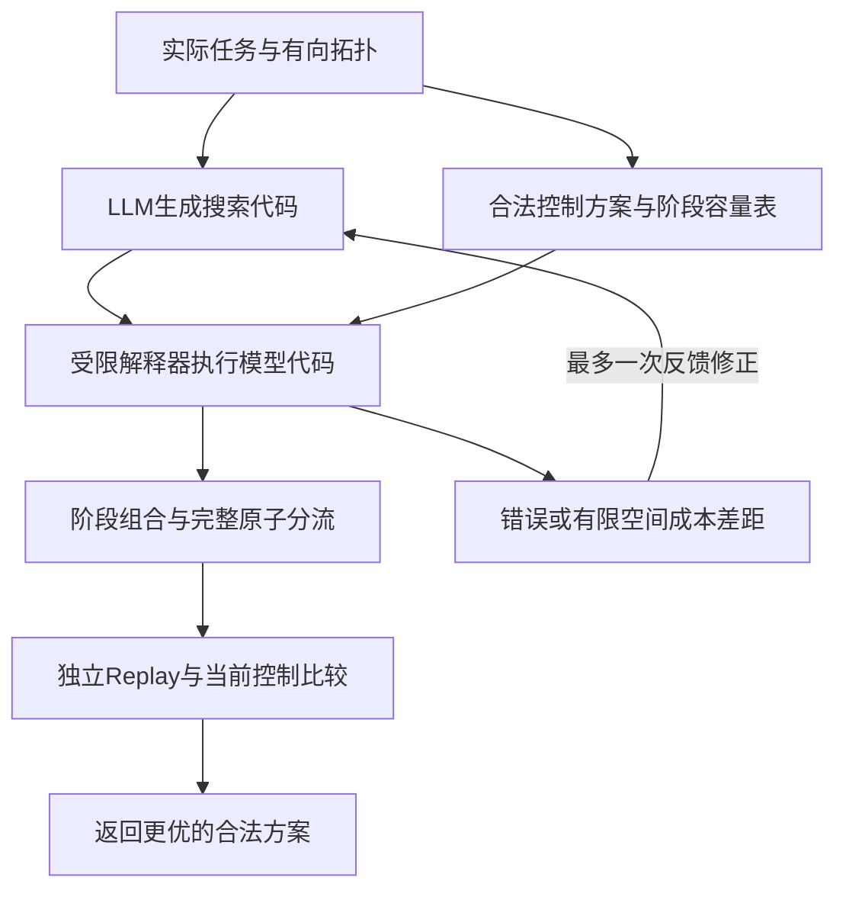

# AgentCC · 1.7

根据本次实际拓扑，为 AllGather / AllReduce 搜索可回放的通信调度。1.7 扩展阶段搜索与多路径分流，并让 LLM **生成可执行的搜索递推代码**：执行当前容量表、检查结果，必要时反馈修正。官方入口保持 `AgentRuntime(MyAgent()).run()`，不训练神经网络、不需要 GPU。

## 从这里开始

| 内容 | 入口 |
| --- | --- |
| 新旧版实测、代价与适用边界 | [VALIDATION.md](VALIDATION.md) |
| 容量模型、代码生成与正确性论证 | [THEORY.md](THEORY.md) |
| 通信、完整请求、CPU、Token 逐例切换 | [1.6 → 1.7 对照报告](artifacts/v1.7/reports/comparison/report.html) |
| 结构探索、消融与失败记录 | [1.7 实验目录](artifacts/v1.7/README.md) |
| 历史平台成绩和源码 | [版本看板](artifacts/index.html) · [版本目录](artifacts/README.md) |
| 本次独立源码 | [v1.7/source](artifacts/v1.7/source/) · [源码包](artifacts/v1.7/agentcc-source-1.7.tar.gz) |

Git 收录当前代码、测试、文档，以及各版 `source/` 发布快照。`materials/`、本地官方 SDK `vendor/`、原始实验和压缩包留在开发服务器，不上传 Git；相应报告链接需在服务器查看。历史快照保持原样，开发在根目录 `src/` 进行。真实 Key 只保存在本地 `.env` 或平台环境变量。

## 题目与输出

输入包含任务、rank、实际有向边、带宽、共享资源及成员边、数据大小、允许切分数和轮数限制。AllGather 让所有 rank 最终拥有所有源的原始数据；AllReduce 先归约互不重叠的贡献，再分发完整归约结果。同轮收到的数据只能从下一轮开始转发。

输出 `solution` 包含初始/最终分片、逐轮 `transfer`、可验证的 `route_id` 和 `metrics`。路径不能使用不存在的边，rank 不能作为单条路径的内部交换节点。共享资源按实际累计负载计算，不能只看单链路带宽。最终正确性和通信耗时由官方 Replay 判定。

已收到的正式调整公告是 **25 分正确性 + 50 分通信 + 25 分求解时间，单例硬时限 360000 ms**。Token 不直接加扣自动榜分；专家与 Token 复核合占综合成绩 30%。另收到的 LLM 代码生成/修改导向，其详细评分和证据要求仍待正式公布，不能把本版实现等同于已经获得专家认可。

## 求解流程



1. **实际容量建模。** 建立合法路径目录，累计每条边和每个共享资源的负载，预览整轮耗时。模型请求与该准备工作重叠。
2. **扩大通信结构。** 允许一次合并 1～3 个逻辑维度，不再受 1.6 的固定小区段边界限制。多原子传输可沿至多四条路径分流；AllReduce 的归约与广播可独立选择阶段边界。
3. **模型编写搜索。** 通常由模型生成 Python 循环，框架只初始化状态和提取结果；轮数限制紧时由模型生成完整搜索函数。代码在执行时读取本次真实容量表，计算阶段宽度序列，而非复述预存答案。模型提示包含当前任务及代表性容量摘要，并不包含全量原始图。
4. **验证、反馈、回退。** 用有界解释器执行代码，检查宽度、阶段、轮数与有限空间成本差距；有收益的候选再编译和完整 Replay。错误或明显次优可反馈一次。仅严格更优的合法结果替换控制方案；失败、拒绝和回退均保留证据。

LLM 编写的是搜索核心片段，路径计算、状态编码、编译与 Replay 是预先实现的工程模块。固定区段的确定性保底也贡献了一部分收益，不能全部归功于模型。没有证明模型优于同空间动态规划，也不声称全局最优。完整通信与求解时间取舍见验证报告。

## 代码结构

```text
src/                            # 镜像只复制这里
  server.py / my_agent.py       # 官方 SDK 入口
  generated_service.py          # 1.7 编排、执行反馈、验收与保底
  code_policy.py                # 实际输入摘要、模型代码协议、原始证据
  program_vm.py                 # 有界 AST 数值解释器，无任意 Python 执行
  stage_search.py               # 阶段容量表、成本审计、方案编译
  striped_stages.py             # 完整原子的多路径分流
  stage_program.py              # AG / AR 多路通信阶段构造
  fabric_routes.py              # 有向路径目录和共享容量核算
  solver.py / collectives.py    # 初解与独立控制候选
  topology.py / replay.py       # 拓扑解析、完整语义和成本验证
  synthesis_service.py          # 1.6 流程；非适用规模的明确回退
  llm.py / config.py            # 官方模型接口、计量与配置
tests/                          # 回归、SDK 对照、消融和扰动
materials/                      # 官方材料、公开样例、论文
vendor/                         # 官方 SDK 原版，仅供本地验证
artifacts/v1.x/                 # 源码、记录、报告、研究试验
```

阶段代码生成适用于 2～512 个、数量为 2 的幂的 rank。其他规模沿用旧的模型调度编辑，并明确记录没有执行本版代码生成。路径目录有工作量上限；超出时保留合法回退。研究原型不从生产代码导入。

## 配置与启动

沿用 `.env` 的 `PLATFORM_LLM_URL`、`PLATFORM_API_KEY`、`PLATFORM_LLM_MODEL`，可选 `AGENTCC_LLM_TIMEOUT_S`。环境变量优先。官方基础环境中运行：

```bash
python -m src.server
```

SDK 监听 `0.0.0.0:8080`，提供 `/health` 和 `/solve`。正式请求外层格式：

```json
{
  "task_id": "实际task_id",
  "task_type": "agentcc",
  "input": {"instance_id": "实际instance_id", "task": {}, "topology": {}},
  "constraints": {"timeout_ms": 360000}
}
```

`task`、`topology` 须填写完整真实数据。响应 `output.answer` 是 solution；`output.diagnostics` 保存原始提示/回复、代码与哈希、实际容量表、执行结果、反馈、采用/拒绝原因及计量。通常一次模型请求，反馈修正最多增加一次；不会用本地合成答案冒充模型响应。

## 本地验证

已有官方基础环境时可省略 `PYTHONPATH=vendor:.`：

```bash
PYTHONPATH=vendor:. python3 -m unittest discover -s tests -v
```

真实模型、完整 SDK 对照（使用新输出目录）：

```bash
PYTHONPATH=vendor:. python3 -m tests.compare_versions --versions 1.6 current --all-public --repeat 3 --output-dir artifacts/v1.7/runs/my-comparison
```

对照包含模型等待、搜索、编译、校验和完整响应解析。公开样例不等于平台冻结实例；本地通过不替代官方 Judge。不要在计时对照期间并行运行其他 CPU 实验。

## 构建、运行与导出

以下命令由用户执行。开发过程没有执行 Docker，也没有代为导出镜像。

```bash
docker build --platform linux/amd64 -t agentcc-team:1.7 /home/czy/agentcc
```

如需本机检查：

```bash
docker run --rm --name agentcc-check --cpus=1 --memory=1024m --pids-limit=256 --env-file /home/czy/agentcc/.env -p 8080:8080 agentcc-team:1.7
```

访问 `http://服务器IP:8080/health`。导出：

```bash
docker save -o /home/czy/agentcc-images/agentcc-team-1.7.tar agentcc-team:1.7
```

基础镜像 `agenthack/base:1.1.1`、非 root 用户 `agent`、官方运行时入口保持不变。只有 `src/` 固化到镜像；`.env`、原始实验、论文、历史源码和本地 SDK 都不打包。平台仍需提供模型环境变量。
